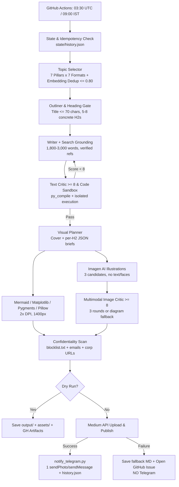

# Autonomous Medium Technical Publishing Pipeline

A GitHub Actions–driven Python pipeline that researches, outlines, writes, validates, illustrates, and publishes **one deeply technical Security Engineering article per day** to Medium, sending a single final notification to Telegram upon success.

## Architecture



## Setup

1. **Fork or clone** this repository and enable GitHub Actions (`Settings → Actions → General → Read and write permissions`).
2. **Configure Repository Secrets** (`Settings → Secrets and variables → Actions`):
   - `GEMINI_API_KEY`: Google Gemini API key (used for topic selection, outlining, writing, Google Search grounding, embeddings, Imagen generation, and multimodal image critique).
   - `MEDIUM_TOKEN`: Medium Integration Token (`https://medium.com/me/settings/security`).
   - `TELEGRAM_BOT_TOKEN`: Telegram Bot API token from `@BotFather`.
   - `TELEGRAM_CHAT_ID`: Target Telegram chat/channel ID.
3. **Optional Variable**:
   - `PUBLISH_STATUS`: Set as a repository variable (`draft`, `public`, or `unlisted`). Defaults to `draft` so you can review the first week before switching to `public`.
4. **Confidentiality Blocklist**:
   - Edit `config/blocklist.txt` and add any internal tool names, codenames, or non-public terms you want strictly blocked before publishing.

## Local Dry Run

```bash
python3 -m venv .venv
source .venv/bin/activate
pip install -r requirements.txt

export GEMINI_API_KEY="your-key"
python -m src.pipeline --dry-run --format "DEEP DIVE"
```

Outputs are written to `output/YYYY-MM-DD-<slug>.md` and `assets/YYYY-MM-DD/manifest.json` without touching Medium or Telegram.

## Customizing Style, Pillars, and Models

- **Models (`config/models.yaml`)**: Update Gemini model IDs (`topic_selector`, `outliner`, `writer`, `grounding`, `text_critic`, `visual_planner`, `image_generator`, `image_critic`, `embedding`) without touching Python code.
- **Content Pillars (`config/pillars.yaml`)**: Edit pillar descriptions, seed themes, and Medium tag pools.
- **Article Formats (`config/formats.yaml`)**: Customize structural requirements for the 7 rotating formats.
- **Visual Brand (`config/style.yaml`)**: Adjust hex colors (`#0B1220` background, `#00E5FF` cyan, `#FFB020` amber), dimensions (`1400x788` cover), DPI, and negative prompts.
- **Prompts (`config/prompts/*.md`)**: Tune persona, critic rubric, or visual planner instructions directly in Markdown.

## Samples

See [`samples/`](samples/) for a complete dry-run article, rendered visuals, `manifest.json`, and critic scores.
