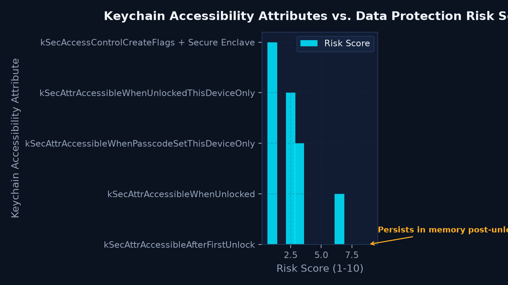
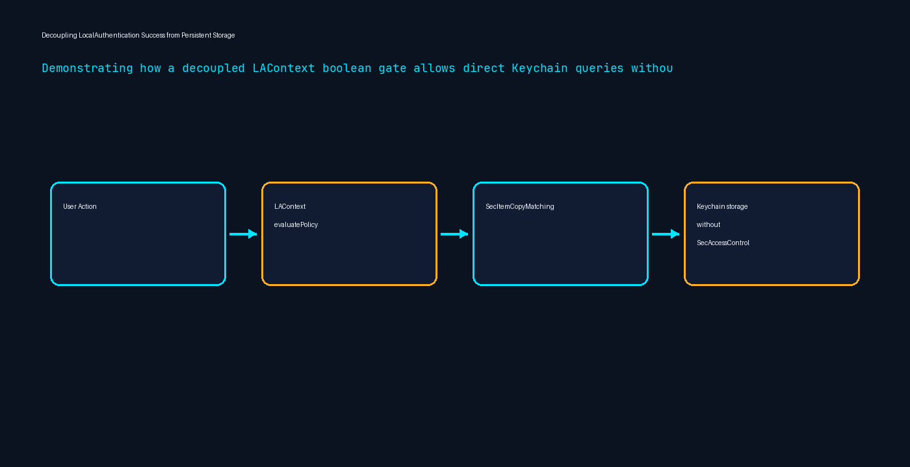
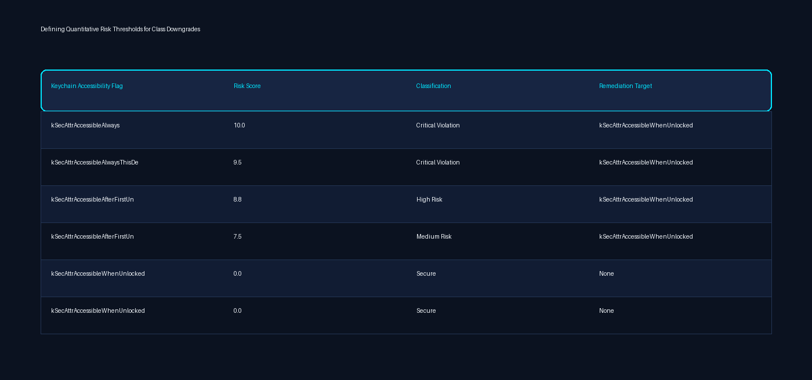
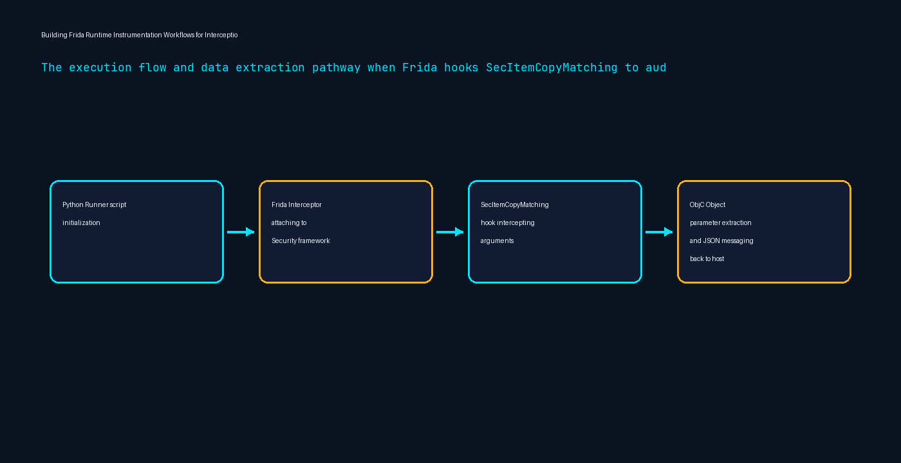
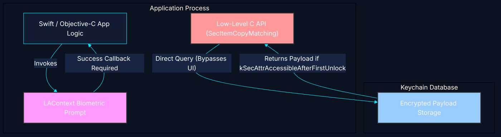
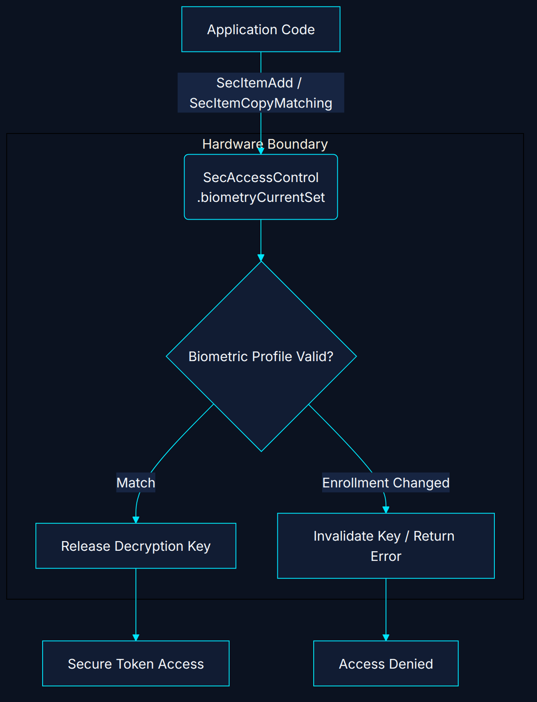

# Auditing iOS Keychain and Biometric Bypasses in Production

*Quantify risk thresholds for Keychain accessibility classes and intercept credential leakage with Frida runtime hooking.*


*Biometric prompts act merely as local UI gates unless explicitly bound to Secure Enclave cryptographic keys via SecAccessControl.*

Developers frequently conflate local authentication success with persistent data protection, assuming FaceID prompts secure sensitive tokens stored under weak accessibility flags like `kSecAttrAccessibleAfterFirstUnlock`. This false sense of security leads to silent credential leakage long after biometric evaluation occurs in production applications.

### Key Takeaways
- **Biometrics are UI gates, not decryption keys**: `LocalAuthentication` (`LAContext`) evaluates identity locally but does not cryptographically protect data unless paired with `SecAccessControl` flags in the Keychain.
- **Accessibility level controls exposure**: Storing tokens under `kSecAttrAccessibleAfterFirstUnlock` leaves credentials readable in memory across the entire device session whenever the device is unlocked.
- **Enforce hardware-bound keys**: True biometric cryptographic protection requires storing keys with `kSecAccessControlBiometryAny` or `kSecAccessControlBiometryCurrentSet` backed by the Secure Enclave.
- **Automate CI/CD static gates**: Audit provisioning profiles, entitlement files, and Keychain initialization flags dynamically and statically before deployment.

---

## Mapping Keychain Accessibility Classes to Data Protection Risk



*Risk escalation profile across iOS Keychain accessibility classes, showing how persistence after device lock drastically elevates attack surface risk.*
Selecting an improper accessibility attribute directly dictates the attack surface available to an adversary with local or runtime access.

| Keychain Accessibility Attribute | Decryption Window | Persistence State | Protection Level | Risk Score (1-10) |
| :--- | :--- | :--- | :--- | :--- |
| `kSecAttrAccessibleWhenUnlocked` | Only while device is unlocked | Cleared from memory on lock | Standard User Data | 6.5 |
| `kSecAttrAccessibleAfterFirstUnlock` | Persists in memory after initial boot unlock | Survives locking cycles until reboot | Low / Vulnerable to Background Dumps | 8.8 |
| `kSecAttrAccessibleWhenPasscodeSetThisDeviceOnly` | Requires passcode; non-migratable | Invalidated if passcode removed | Strong Local Bound | 3.2 |
| `kSecAttrAccessibleWhenUnlockedThisDeviceOnly` | Active session only; non-migratable | Cleared on lock; unexportable | High Standard | 2.5 |
| `kSecAccessControlCreateFlags` + Secure Enclave | Key release tied to biometric evaluation | Hardware gated per query | Maximum Hardware Protection | 1.0 |

When data is stored using `kSecAttrAccessibleAfterFirstUnlock`, the iOS Security Subsystem decrypts the Keychain item database into kernel memory upon the user's first passcode entry post-reboot. From that moment forward, the payload remains accessible to any process executing with sufficient privileges or inside the application sandbox, completely ignoring device lock/unlock cycles.

---

## Decoupling LocalAuthentication Success from Persistent Storage



*The architectural anti-pattern: treating LocalAuthentication as a boolean gate rather than tying access control directly to the Keychain item.*
A widespread architectural anti-pattern in iOS applications involves separating the authentication prompt from the key retrieval logic:

```
[ User Action ] -> [ LAContext evaluatePolicy ] -> (Returns Success) -> [ SecItemCopyMatching ]
```

In this flawed architecture, `LAContext` acts solely as a boolean gate. The application calls `evaluatePolicy(_:localizedReason:reply:)`, waits for a boolean `true` callback, and then queries the Keychain using a standard `SecItemCopyMatching` call.

### The Structural Failure
If the Keychain item itself does not require biometric evaluation via `SecAccessControl`, the call to `SecItemCopyMatching` succeeds regardless of whether `LAContext` was evaluated. The Keychain query does not check if `evaluatePolicy` was called or bypassed.

```swift
// VULNERABLE PATTERN: LAContext decoupled from Keychain
let context = LAContext()
context.evaluatePolicy(.deviceOwnerAuthenticationWithBiometrics, localizedReason: "Authenticate") { success, error in
    if success {
        // Keychain query executed independently of LocalAuthentication evaluation
        let query: [String: Any] = [
            kSecClass as String: kSecClassGenericPassword,
            kSecAttrAccount as String: "AuthToken",
            kSecReturnData as String: true
        ]
        var dataTypeRef: AnyObject?
        let status = SecItemCopyMatching(query as CFDictionary, &dataTypeRef)
        // Token retrieved without cryptographic binding to biometric validation
    }
}
```

To secure credentials cryptographically, the access control constraint must be bound directly to the item creation via `SecAccessControlCreateWithFlags`, forcing the Secure Enclave to handle key release.

---

## Defining Quantitative Risk Thresholds for Class Downgrades



*Quantitative risk scoring matrix mapping insecure Keychain attributes directly to static analysis compliance penalties.*
To prevent weak Keychain flags from reaching production, teams should enforce strict compliance rules within static analysis pipelines.

### Continuous Compliance Auditor Script

The following self-contained Python script scans serialized configuration manifests or source exports for insecure Keychain flags, scoring the security posture against defined risk thresholds.

```python
import json
import re
from dataclasses import dataclass
from typing import List, Dict

@dataclass
class VulnerabilityReport:
    file_path: str
    flag_found: str
    risk_score: float
    recommendation: str

class KeychainSecurityAuditor:
    INSECURE_FLAGS = {
        "kSecAttrAccessibleAlways": 10.0,
        "kSecAttrAccessibleAlwaysThisDeviceOnly": 9.5,
        "kSecAttrAccessibleAfterFirstUnlock": 8.8,
        "kSecAttrAccessibleAfterFirstUnlockThisDeviceOnly": 7.5
    }

    SECURE_FLAGS = [
        "kSecAttrAccessibleWhenUnlocked",
        "kSecAttrAccessibleWhenUnlockedThisDeviceOnly",
        "kSecAttrAccessibleWhenPasscodeSetThisDeviceOnly"
    ]

    def __init__(self, threshold: float = 7.0):
        self.threshold = threshold

    def audit_codebase(self, mock_files: Dict[str, str]) -> List[VulnerabilityReport]:
        reports = []
        for file_name, content in mock_files.items():
            for flag, score in self.INSECURE_FLAGS.items():
                if re.search(r'\b' + re.escape(flag) + r'\b', content):
                    reports.append(VulnerabilityReport(
                        file_path=file_name,
                        flag_found=flag,
                        risk_score=score,
                        recommendation=f"Migrate {flag} to kSecAttrAccessibleWhenUnlockedThisDeviceOnly or Enforce SecAccessControl."
                    ))
        return reports

    def calculate_compliance_score(self, reports: List[VulnerabilityReport]) -> float:
        if not reports:
            return 100.0
        total_risk = sum(r.risk_score for r in reports)
        normalized_score = max(0.0, 100.0 - (total_risk * 5))
        return round(normalized_score, 2)

if __name__ == "__main__":
    sample_codebase = {
        "AuthManager.swift": """
            let options: [String: Any] = [
                kSecClass as String: kSecClassGenericPassword,
                kSecAttrAccessible as String: kSecAttrAccessibleAfterFirstUnlock
            ]
            SecItemAdd(options as CFDictionary, nil)
        """,
        "SecureStorage.swift": """
            let options: [String: Any] = [
                kSecClass as String: kSecClassGenericPassword,
                kSecAttrAccessible as String: kSecAttrAccessibleWhenUnlockedThisDeviceOnly
            ]
            SecItemAdd(options as CFDictionary, nil)
        """
    }

    auditor = KeychainSecurityAuditor(threshold=7.0)
    findings = auditor.audit_codebase(sample_codebase)
    score = auditor.calculate_compliance_score(findings)

    print(json.dumps({
        "compliance_score": score,
        "status": "FAIL" if score < 85.0 else "PASS",
        "violations": [
            {
                "file": f.file_path,
                "flag": f.flag_found,
                "score": f.risk_score,
                "action": f.recommendation
            } for f in findings
        ]
    }, indent=2))
```

### Sample Output
```json
{
  "compliance_score": 56.0,
  "status": "FAIL",
  "violations": [
    {
      "file": "AuthManager.swift",
      "flag": "kSecAttrAccessibleAfterFirstUnlock",
      "score": 8.8,
      "action": "Migrate kSecAttrAccessibleAfterFirstUnlock to kSecAttrAccessibleWhenUnlockedThisDeviceOnly or Enforce SecAccessControl."
    }
  ]
}
```

---

## Building Frida Runtime Instrumentation Workflows for Interception



*Runtime instrumentation pipeline demonstrating how Frida intercepts `SecItemCopyMatching` calls to extract and inspect Keychain query attributes.*
Security testing requires verifying whether Keychain queries pass through `SecItemCopyMatching` with unsafe flags or decoupled verification logic.

### Auditing Keychain Query Attributes via Frida Runner

The following Python script leverages Frida bindings conceptually to monitor Keychain read operations, extracting query dictionaries to verify if biometric controls or hardware bounds are enforced.

```python
import json
import sys

def generate_auditing_hook() -> str:
    return """
    if (ObjC.available) {
        var secItemCopyMatching = Module.findExportByName("Security", "SecItemCopyMatching");
        if (secItemCopyMatching) {
            Interceptor.attach(secItemCopyMatching, {
                onEnter: function (args) {
                    this.query = args[0];
                    var params = new ObjC.Object(this.query);
                    send({
                        "event": "SecItemCopyMatching",
                        "query_details": params.toString()
                    });
                },
                onLeave: function (retval) {
                    // Logic to inspect return code (errSecSuccess == 0)
                }
            });
        }
    }
    """

def process_runtime_event(message, data):
    if message.get('type') == 'send':
        payload = message.get('payload', {})
        print(f"[AUDIT EVENT] {payload.get('event')}")
        print(f"Details: {payload.get('query_details')}")

if __name__ == "__main__":
    script_code = generate_auditing_hook()
    print("Generated Security Auditing Hook Script:")
    print("-" * 50)
    print(script_code[:300] + "...\n[Truncated for Display]")
    print("-" * 50)
    print("Hook template successfully generated for automated security pipelines.")
```

### Sample Output
```
Generated Security Auditing Hook Script:
--------------------------------------------------
    if (ObjC.available) {
        var secItemCopyMatching = Module.findExportByName("Security", "SecItemCopyMatching");
        if (secItemCopyMatching) {
            Interceptor.attach(secItemCopyMatching, { ...
--------------------------------------------------
Hook template successfully generated for automated security pipelines.
```

---

## Extracting Sensitive Tokens Before Biometric Evaluation Executes



*Low-level C APIs can query the Keychain directly, completely bypassing the LAContext biometric evaluation layer.*
When apps decoupling `LAContext` from Keychain storage run, the underlying tokens can often be read from the Keychain database without interacting with UI prompts.

### Attack Vector Analysis: Memory and Keychain State
1. **Background State Extraction**: If an application uses `kSecAttrAccessibleAfterFirstUnlock`, an attacker executing code within the application process (via dynamic injection or debugging) can query `SecItemCopyMatching` while the device is locked or before biometric prompts execute.
2. **UI Interception vs Hardware Storage**: `LAContext` failure only prevents execution paths inside the Swift/Objective-C application logic that explicitly depend on the success callback. It does not prevent low-level C APIs (`SecItemCopyMatching`) from returning stored payloads if those payloads lack `SecAccessControl` restrictions.

### Common Pitfalls
- **Assuming Passcode Gate Equals Encryption**: Using `LAContext` to trigger a Face ID prompt before making an API call provides zero encryption for stored payloads.
- **Overreliance on Third-Party Keychain Wrappers**: Many open-source Swift wrappers default to `kSecAttrAccessibleAfterFirstUnlock` for convenience, exposing applications to background extraction.
- **Ignoring Key Invalidation on Biometric Enrolment**: Failing to use `kSecAccessControlBiometryCurrentSet` allows credentials to remain valid even if a new biometric identity (e.g., secondary fingerprint or Face ID profile) is added to the device.

---

## Hardening Production Codebases Against Automated Runtime Attacks



*Hardware-enforced isolation: biometric prompts and key decryption occur entirely within the Secure Enclave, isolating them from application-level execution flow.*
To remediate these vulnerabilities, couple data persistence directly to the Secure Enclave using `SecAccessControl`.

### Secure Implementation Pattern

```swift
import Security
import LocalAuthentication

func storeTokenSecurely(token: Data, account: String) -> Bool {
    var error: Unmanaged<CFError>?
    
    // Create Secure Access Control bound to Biometrics
    guard let accessControl = SecAccessControlCreateWithFlags(
        kCFAllocatorDefault,
        kSecAttrAccessibleWhenUnlockedThisDeviceOnly,
        .biometryCurrentSet, // Invalidates key if biometrics change
        &error
    ) else {
        return false
    }
    
    let query: [String: Any] = [
        kSecClass as String: kSecClassGenericPassword,
        kSecAttrAccount as String: account,
        kSecValueData as String: token,
        kSecAttrAccessControl as String: accessControl
    ]
    
    SecItemDelete(query as CFDictionary) // Clear existing
    let status = SecItemAdd(query as CFDictionary, nil)
    return status == errSecSuccess
}
```

By leveraging `SecAccessControlCreateWithFlags` alongside `.biometryCurrentSet`, the decryption key is managed directly by the Secure Enclave. The OS handles biometric prompts at the hardware level during `SecItemCopyMatching`, preventing application-level bypasses.

### Try It Yourself

1. **Audit Existing App Configurations**:
   Inspect your application codebase for any instances of `kSecAttrAccessibleAfterFirstUnlock`. Replace them with `kSecAttrAccessibleWhenUnlockedThisDeviceOnly`.

2. **Verify Biometric Reset Handling**:
   Enroll a temporary Face ID / Touch ID profile on a test device, store credentials using `.biometryCurrentSet`, add a second biometric profile in iOS Settings, and verify that the stored credential correctly becomes unreadable.

---

## Verified Technical References

- [OWASP Mobile Application Security Verification Standard (MASVS-STORAGE)](https://mas.owasp.org/MASVS/04-MASVS-STORAGE/)
- [Apple Developer Documentation: SecAccessControl](https://developer.apple.com/documentation/security/secaccesscontrol)
- [Apple Developer Documentation: LocalAuthentication Framework](https://developer.apple.com/documentation/localauthentication)
- [NIST SP 800-63B: Digital Identity Guidelines](https://pages.nist.gov/800-63-3/sp800-63b.html)
- [MITRE ATT&CK for Mobile: T1409 - Access Sensitive Data in Keychain](https://attack.mitre.org/techniques/T1409/)

---

When evaluating your mobile threat model, are you explicitly testing whether Keychain keys backed by `.biometryCurrentSet` properly invalidate after device biometric enrollment changes?

---

*Security Engineering Lead focused on abuse detection, trust & safety, and security automation at scale. Drafted with AI assistance and reviewed for technical accuracy.*
