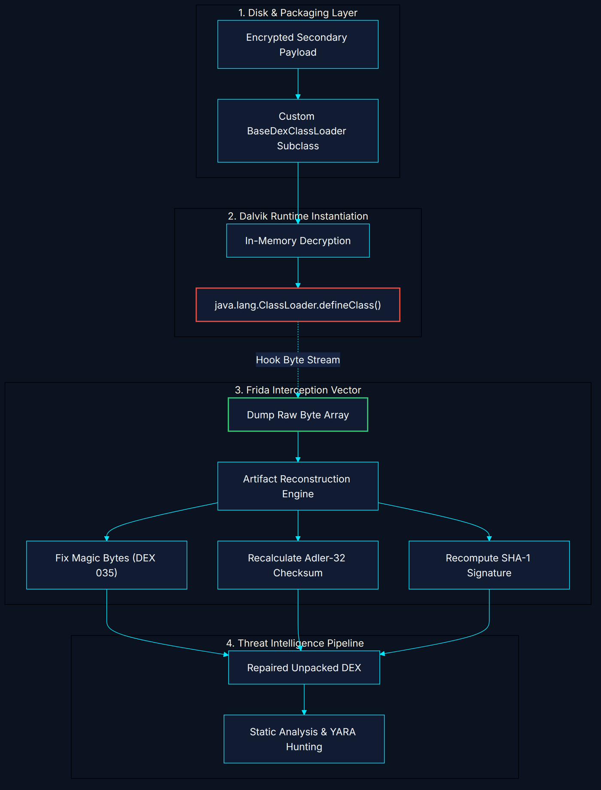
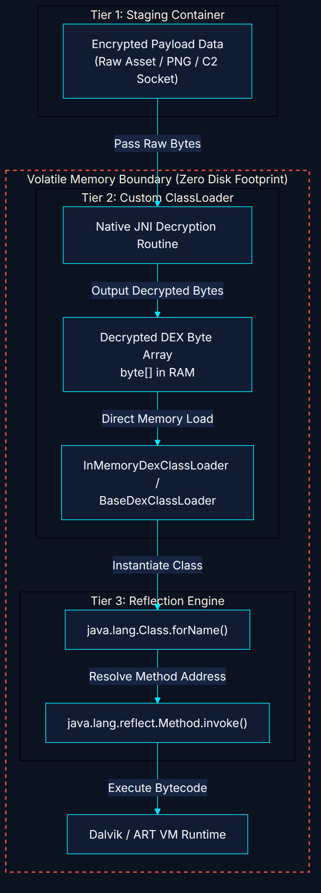
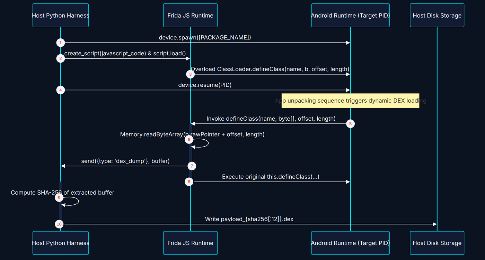
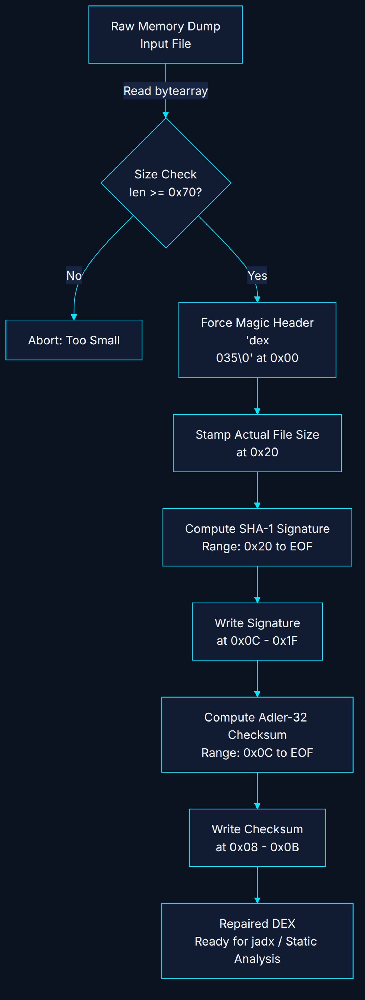
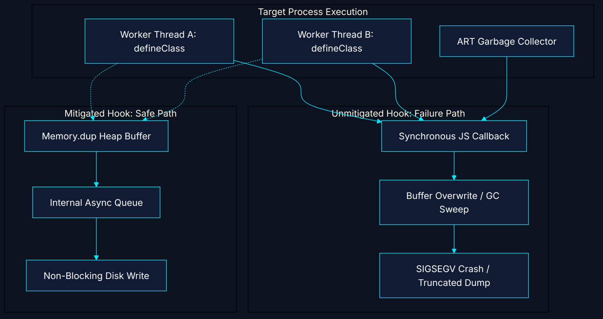
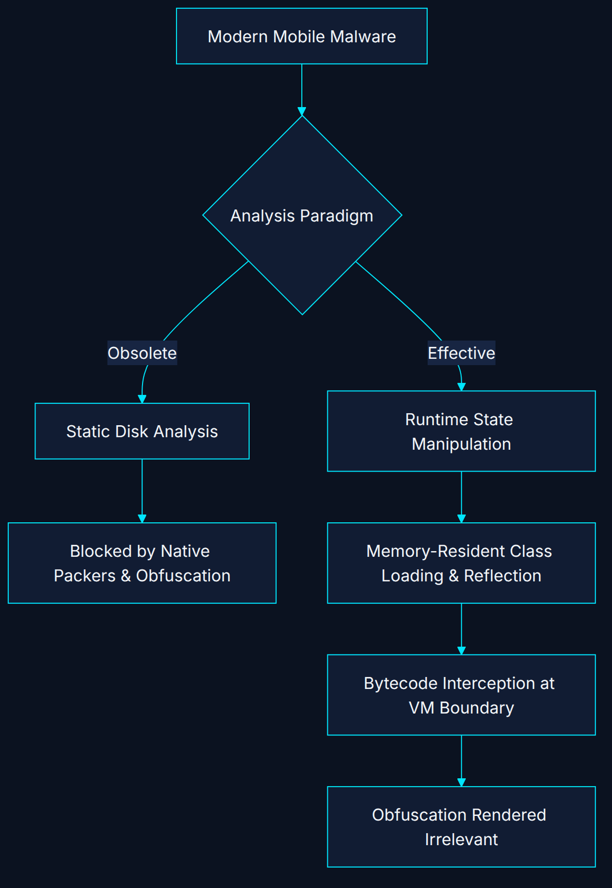

# Deobfuscating DEX Loading Chains with Custom ClassLoader Hooks

*Intercept reflection and custom class loaders via Frida to dump and analyze multi-stage banking trojan payloads in memory.*


*Intercepting memory payloads at java.lang.ClassLoader.defineClass captures decrypted Dalvik bytecode prior to runtime verification.*

Modern Android banking trojans bypass static signature scanners by assembling secondary payloads purely in memory through multi-stage reflection and custom class loaders. When automated static analysis pipelines yield empty results against packed DEX files, security engineers must intercept the exact moment of Dalvik bytecode instantiation to extract unencrypted artifacts.

> ### TL;DR / Key Takeaways
> - **The Problem:** Modern malware conceals payloads by loading encrypted byte arrays directly into memory using custom `BaseDexClassLoader` subclasses, rendering disk-based static scanners blind.
> - **The Interception Vector:** Frida hooks target `java.lang.ClassLoader.defineClass` to capture raw, unencrypted byte arrays right before Dalvik verification occurs.
> - **The Repair Process:** Memory dumps of DEX files often contain corrupted magic headers, zeroed Adler-32 checksums, or stripped SHA-1 signatures that require programmatic reconstruction.
> - **The Automation Pipeline:** Extracted artifacts are fed directly into static analysis tools and custom YARA detection rules to scale threat hunting operations.

---

## Anatomy of Multi-Stage Reflection and Custom ClassLoaders



*By decrypting byte arrays directly into dynamic memory and resolving entry points via reflection, advanced Android malware avoids leaving executable artifacts on the device filesystem.*
Traditional Android application packaging stores executable code in standard `classes.dex` containers within an APK archive. Analysts can easily extract these files using `unzip` and parse them with tools like `jadx` or `baksmali`. Advanced banking trojans completely abandon this convention. Instead, they ship with a minimal stub application whose sole purpose is to fetch, decrypt, and load secondary payloads at runtime.

The execution chain typically follows three distinct tiers:

1. **The Staging Container:** The host APK contains encrypted payloads hidden inside raw asset files, PNG metadata, or pulled via encrypted sockets from Command and Control (C2) servers.
2. **The Custom ClassLoader:** The malware instantiates a subclass of `dalvik.system.BaseDexClassLoader` or `dalvik.system.InMemoryDexClassLoader`. By overriding the loading mechanism, the process feeds decrypted byte arrays directly into memory without writing a secondary `.dex` or `.jar` file to disk.
3. **The Reflection Engine:** To avoid static API call detection (such as explicit references to `DexClassLoader`), the malware constructs method invocation chains dynamically using `java.lang.Class.forName` and `java.lang.reflect.Method.invoke`.

```
[Encrypted Payload / Network] 
          │
          ▼
[Native JNI Decryption Routine] 
          │
          ▼
[In-Memory Byte Array (Raw DEX)] 
          │
          ▼
[Custom BaseDexClassLoader / defineClass()] ──> [Dalvik VM Execution]
```

When you examine the filesystem of an infected device, you find nothing. The APK static footprint remains pristine, yet the application executes fully functional, highly malicious bytecode inside the Dalvik/ART virtual machine.

---

## Architecting Frida Instrumentation for In-Memory Payload Extraction



*Interception sequence showing early process attachment, ClassLoader hooking, and asynchronous buffer extraction to host disk before bytecode execution.*
To capture payloads before execution, you must intercept the runtime boundary where raw bytes transform into executable classes. In the Android runtime environment, every class loader eventually delegates bytecode definition to low-level native or managed methods.

Targeting `java.lang.ClassLoader.defineClass` allows you to intercept the byte array regardless of how obfuscated the upstream reflection chain appears. Below is a production-grade Python automation harness using the Frida Python bindings to spawn an application, attach early instrumentation, and write captured DEX files to local disk for analysis.

```python
import sys
import frida
import hashlib
import os

PACKAGE_NAME = "com.malware.banking.trojan"
OUTPUT_DIR = "./dumped_dex"

javascript_code = """
Java.perform(function() {
    try {
        var ClassLoader = Java.use("java.lang.ClassLoader");
        var Log = Java.use("android.util.Log");
        
        // Intercept defineClass to capture raw DEX byte arrays
        ClassLoader.defineClass.overload(
            'java.lang.String', '[B', 'int', 'int'
        ).implementation = function(name, b, offset, length) {
            console.log("[*] Intercepted defineClass for: " + (name ? name : "anonymous"));
            
            if (b !== null && length > 0) {
                var buffer = Memory.readByteArray(b.rawPointer + offset, length);
                send({
                    "type": "dex_dump",
                    "name": name ? name.toString() : "unknown"
                }, buffer);
            }
            
            return this.defineClass(name, b, offset, length);
        };
        console.log("[+] Hook installed successfully on ClassLoader.defineClass");
    } catch (err) {
        console.log("[-] Error hooking ClassLoader: " + err.message);
    }
});
"""

def on_message(message, data):
    if message['type'] == 'send':
        payload_meta = message['payload']
        if payload_meta.get('type') == 'dex_dump' and data:
            os.makedirs(OUTPUT_DIR, exist_ok=True)
            sha256_hash = hashlib.sha256(data).hexdigest()
            filename = os.path.join(OUTPUT_DIR, f"payload_{sha256_hash[:12]}.dex")
            
            with open(filename, "wb") as f:
                f.write(data)
            print(f"[+] Saved DEX payload: {filename} ({len(data)} bytes)")
    elif message['type'] == 'error':
        print(f"[-] Script error: {message.get('stack')}")

def main():
    try:
        device = frida.get_usb_device()
        pid = device.spawn([PACKAGE_NAME])
        session = device.attach(pid)
        script = session.create_script(javascript_code)
        script.on('message', on_message)
        script.load()
        device.resume(pid)
        print(f"[*] Instrumenting {PACKAGE_NAME} (PID: {pid}). Press Ctrl+C to exit.")
        sys.stdin.read()
    except Exception as e:
        print(f"[-] Execution failed: {e}")

if __name__ == "__main__":
    main()
```

This harness attaches to the process before any application code executes, ensuring that early-stage unpackers cannot evade detection by unhooking Frida post-initialization.

---

## Reconstructing Defanged DEX Files via Dalvik Bytecode Manipulation



*Sequential byte-patching pipeline transforming a defanged memory dump into a parser-compatible DEX structure.*
Dumps captured directly from memory are frequently imperfect. Malware authors often intentionally corrupt DEX headers, zero out checksum fields, or manipulate file sizes to throw off standard parsers and disassemblers. Feeding a raw memory dump directly into `jadx` often results in parsing errors or empty output folders.

To make the dumped binary readable by static analysis engines, you must reconstruct the DEX header according to the official Android Open Source Project (AOSP) specifications.

| Offset (Hex) | Size (Bytes) | Field Name | Description / Expected Value |
| :--- | :--- | :--- | :--- |
| `0x00` | 8 | `magic` | Magic value: `dex\n035\0` (or `036`/`037` for newer ART versions) |
| `0x08` | 4 | `checksum` | Adler-32 checksum of the rest of the file (from offset `0x0C` to EOF) |
| `0x0C` | 20 | `signature` | SHA-1 hash of the rest of the file (from offset `0x20` to EOF) |
| `0x20` | 4 | `fileSize` | Total size of the DEX file in bytes |
| `0x24` | 4 | `headerSize` | Size of the header (normally `0x70` bytes) |

The following standalone Python script takes a raw, potentially corrupted DEX memory dump, recalculates its Adler-32 checksum, computes the correct SHA-1 signature, and normalizes the file size field.

```python
import sys
import struct
import zlib
import hashlib

def repair_dex(input_path, output_path):
    with open(input_path, "rb") as f:
        data = bytearray(f.read())
    
    if len(data) < 0x70:
        print("[-] Error: File too small to be a valid DEX payload.")
        return False

    # Force correct DEX magic header if corrupted
    magic = b"dex\n035\0"
    data[0:8] = magic

    # Fix file size field at offset 0x20
    actual_size = len(data)
    struct.pack_into("<I", data, 0x20, actual_size)

    # Compute SHA-1 signature over the file starting from offset 0x20 to EOF
    sha1 = hashlib.sha1(data[0x20:])
    signature = sha1.digest()
    data[0x0C:0x20] = signature

    # Compute Adler-32 checksum over the file starting from offset 0x0C to EOF
    # Note: zlib adler32 operates on bytes
    adler = zlib.adler32(data[0x0C:]) & 0xFFFFFFFF
    struct.pack_into("<I", data, 0x08, adler)

    with open(output_path, "wb") as f:
        f.write(data)
    
    print(f"[+] Repaired DEX written to {output_path}")
    print(f"    - Size: {actual_size} bytes")
    print(f"    - Checksum: 0x{adler:08X}")
    print(f"    - SHA-1: {signature.hex()}")
    return True

if __name__ == "__main__":
    if len(sys.argv) < 3:
        print("Usage: python repair_dex.py <raw_dump.dex> <repaired.dex>")
        sys.exit(1)
    repair_dex(sys.argv[1], sys.argv[2])
```

---

## Failure-Mode Analysis of Memory Dumps and Timing Attacks



*Synchronous memory logging creates lock contention and GC races; offloading buffer allocation via Memory.dup() prevents SIGSEGV crashes.*
Intercepting runtime loading chains is rarely frictionless. Malware authors build defensive checks into their unpacking routines, leading to predictable failure modes during dynamic analysis.

### Common Pitfalls

1. **Asynchronous Decryption Windows:** If the payload decryption routine executes inside a worker thread delayed by a `Thread.sleep()` or triggered by a specific UI interaction, spawning the app and immediately dumping classes will yield zero results. The Frida script must persist across activity lifecycles.
2. **Garbage Collection (GC) Race Conditions:** When a custom class loader instantiates temporary byte arrays for reflection, aggressive ART garbage collection can sweep memory blocks before the instrumentation hook logs the pointer range, resulting in truncated or null buffer reads.
3. **Multi-Threaded Locking Contention:** Banking trojans frequently employ multi-threaded unpacking to complicate analysis. Simultaneous calls to `defineClass` from different native worker threads can cause race conditions in unoptimized Frida scripts, crashing the target process (`SIGSEGV`).

```
[Target Process Threads] ──(Simultaneous defineClass)──> [Hook Bottleneck]
                                                              │
                                                     (Buffer Overwrite / 
                                                      GC Sweep Collision)
                                                              │
                                                              ▼
                                                    [Process SIGSEGV Crash]
```

### Mitigation Strategies
To bypass multi-threading crashes, avoid heavy synchronous operations inside the Frida JavaScript callback. Instead, quickly copy memory buffers into native heap space using `Memory.dup()` or push references to an internal asynchronous queue before writing to disk.

---

## Automating Production Threat Hunting Pipelines with Extracted Artifacts


*Automated ingestion pipeline transforming dynamic memory dumps into static IOCs, YARA signatures, and dynamic build policy checks.*
Manual extraction does not scale when analyzing threat actor infrastructure that pushes dozens of polymorphic payloads daily. Production-grade mobile AppSec pipelines automate the entire extraction, repair, and triage cycle.

Once a DEX file is successfully captured and repaired using scripts like those detailed above, the automated pipeline should execute three immediate actions:

1. **Static Analysis Integration:** Pipe the repaired `.dex` binary directly into headless analysis tools (such as MobSF API or Ghidra headless analyzers) to extract imported API strings, URLs, and cryptographic keys.
2. **YARA Rule Generation:** Extract unique method signature byte sequences or embedded string constants from the reconstructed DEX payload to generate targeted YARA rules for network-wide threat hunting.
3. **CI/CD Security Gates:** Integrate dynamic instrumentation hooks into mobile application build pipelines to verify that legitimate third-party SDKs do not inadvertently trigger dynamic class loading behaviors characteristic of malware behavior.

---

### Try It Yourself

Execute this controlled experiment on a test device or emulator:
1. Write a trivial Android application that loads a secondary array using `InMemoryDexClassLoader`.
2. Deploy the Frida instrumentation harness provided in Section 2.
3. Observe how the raw bytes are captured even when obfuscated behind JNI wrappers.
4. Intentionally corrupt the magic header of the captured dump and run the `repair_dex.py` script to restore parsing compatibility with `jadx`.

---

## Closing Insight



*Shifting analysis from static disk artifacts to runtime VM boundaries neutralizes native packing and obfuscation.*
Static analysis of modern mobile malware is obsolete the moment an application relies on runtime reflection and memory-resident class loading. Security engineers must shift focus from disk artifacts to runtime state manipulation. By intercepting bytecode at the exact boundary of VM instantiation, you render payload obfuscation irrelevant.

What specific challenges have you encountered when dealing with native packers that employ anti-instrumentation checks alongside in-memory class loading? Share your debugging approach in the comments below.

---

## References

- **OWASP Mobile Top 10:** M9 Reverse Engineering and Tampering, [OWASP Foundation](https://owasp.org/www-project-mobile-top-10/)
- **MITRE ATT&CK Mobile:** Technique T1624.001 - Native Code Generation, [MITRE Corporation](https://attack.mitre.org/techniques/T1624/001/)
- **Android Open Source Project:** ClassLoader and DexClassLoader Specifications, [AOSP Documentation](https://source.android.com/)
- **NIST SP 800-83 Rev. 1:** Guide to Malware Incident Prevention and Handling for Desktops and Laptops, [NIST Computer Security Resource Center](https://csrc.nist.gov/publications/detail/sp/800-83/rev-1/final)
- **Frida Documentation:** Intercepting Java Methods and Native Functions, [Frida.re Project Hub](https://frida.re/docs/home/)

---

*Security Engineering Lead focused on abuse detection, trust & safety, and security automation at scale. Drafted with AI assistance and reviewed for technical accuracy.*
