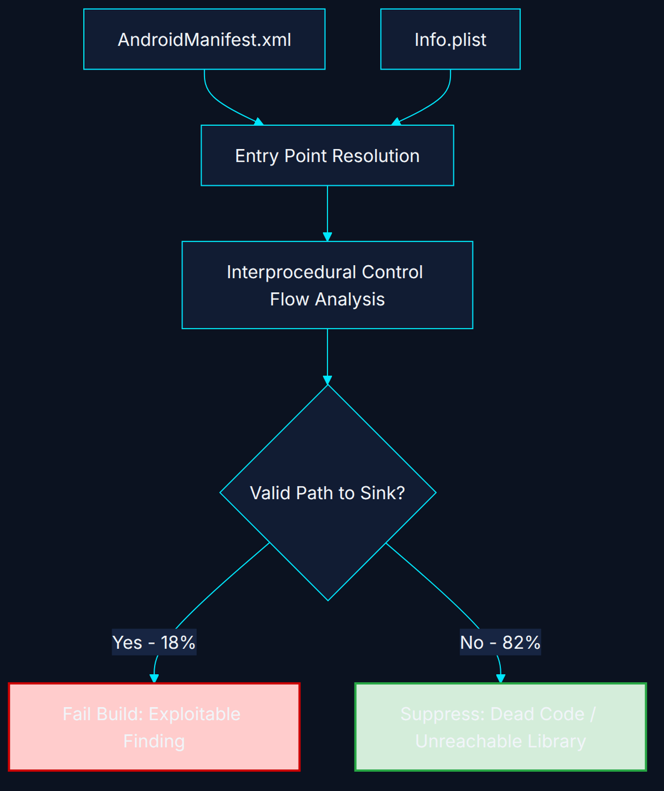
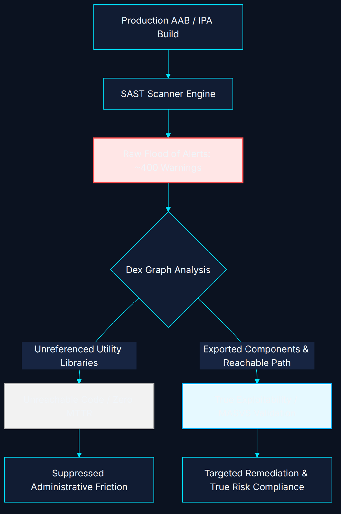
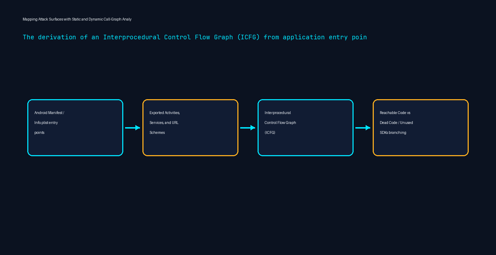
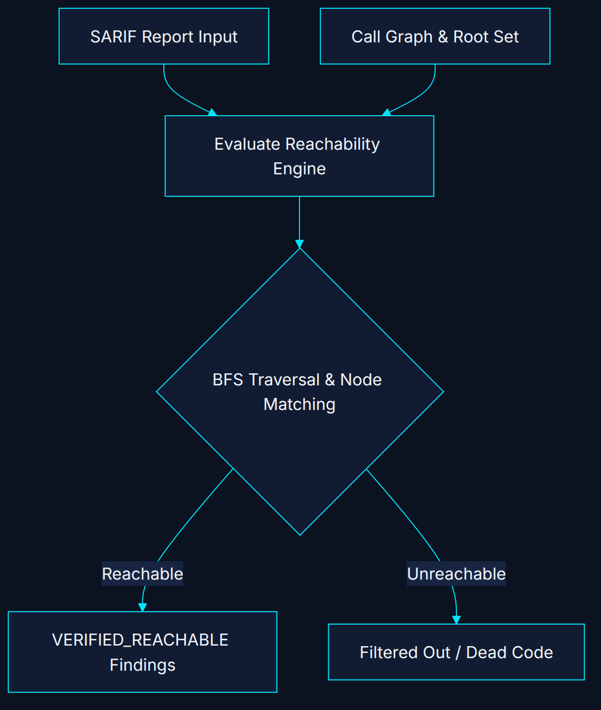
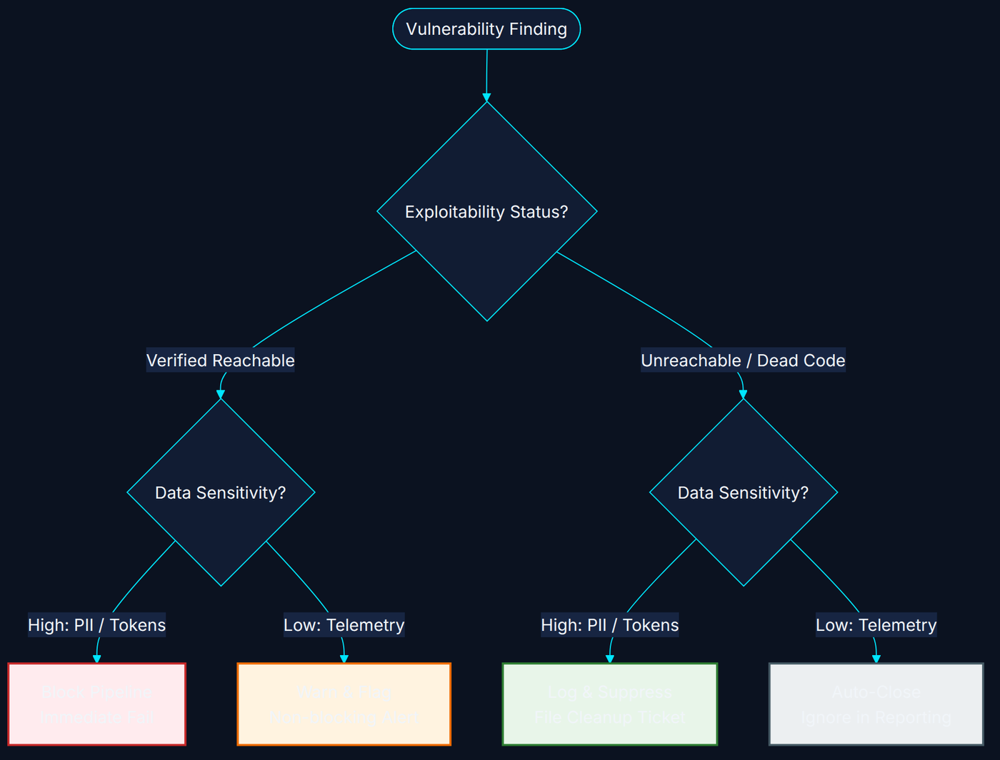
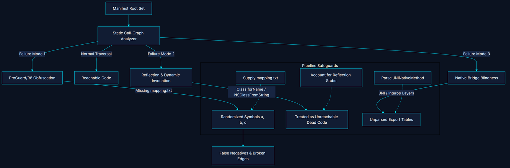
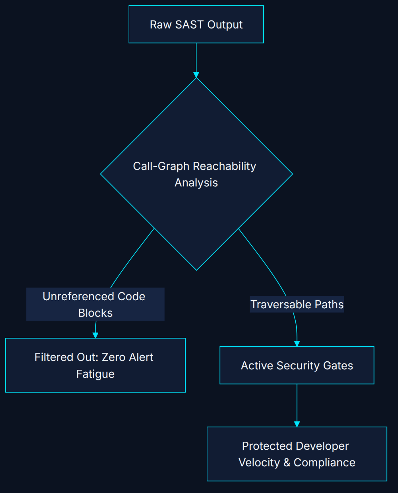

# Gating Mobile CI/CD with Call-Graph Reachability Analysis

*Cut SAST alert fatigue by 82% using automated call-graph reachability checks to block only exploitable mobile vulnerabilities.*


*Interprocedural analysis maps entry points to vulnerability sinks, filtering out 82% of dead-code alerts before breaking the build.*

Your mobile SAST scanner flags 400 vulnerabilities per build, but 82% of them reside in dead code or unreachable third-party libraries. Blindly blocking releases on these static alerts destroys developer velocity without improving MASVS compliance.

### TL;DR / Key Takeaways
* **Stop blocking on dead code:** Up to 80% of static analysis findings in modern mobile apps sit in code paths that cannot be reached from application entry points.
* **Build reachability gates:** Use interprocedural control flow analysis to correlate SAST findings with actual application entry points (`AndroidManifest.xml` and `Info.plist`).
* **Enforce strict paths:** Drop builds only when a valid, non-null call-graph path exists from an entry point to the vulnerability sink.
* **Reduce triage toil:** Cut false positive noise to reclaim thousands of engineering hours per year and restore trust in automated security pipelines.

---

## Quantifying Alert Fatigue and the Cost of Unverified SAST Findings



*Filtering static SAST alerts through dynamic dex graph reachability transforms 400 raw warnings into actionable, high-confidence risk metrics.*
Mobile application security testing often collapses under its own weight. When a traditional static application security testing (SAST) tool scans a production-ready Android App Bundle (AAB) or iOS IPA, it performs syntactic and semantic pattern matching across millions of lines of bytecode, third-party SDKs, and compiled dependencies. The result is a flood of alerts—often numbering in the hundreds per build—categorized with generic high, medium, or low severities. 

In high-frequency release environments, forcing mobile engineers to manually triage 400 warnings per sprint cycle introduces severe operational friction. Engineers quickly learn to bypass checks, disable rules, or view security tooling as an administrative speed bump. More dangerously, security teams waste hundreds of hours investigating vulnerabilities inside unreferenced utility libraries, unused native binaries, or unreachable helper classes.

To measure this properly, security engineering teams must track finding density against true exploitability. If your scanner flags a cryptographic weakness in a Java library class that is never instantiated by the app's dex graph, the Mean Time to Resolution (MTTR) for that ticket should be zero minutes because the risk exposure is zero. Static findings mapped against the OWASP Mobile Application Security Verification Standard (MASVS) checklist frequently inflate compliance metrics. An app might fail MASVS-CRYPTO-1 because an insecure cipher exists somewhere in the dependency tree, even if the application's exported components never invoke that cipher. By establishing baseline metrics that separate static presence from dynamic reachability, security teams can target true risk rather than raw finding counts.

---

## Mapping Attack Surfaces with Static and Dynamic Call-Graph Analysis



*Filtering unexploitable dead code by traversing directed edges outward from the application's root set.*
To separate theoretical findings from exploitable vulnerabilities, you must deconstruct the compiled bytecode—DEX for Android or Mach-O for iOS—to construct interprocedural control flow graphs (ICFGs). An ICFG maps all possible execution paths through the program, capturing method invocations, interface implementations, and inter-component communication (ICC) vectors.

```
[Android Manifest / Info.plist] (Entry Points)
               │
               ▼
[Exported Activities / Services / URL Schemes]
               │
               ▼
[Interprocedural Control Flow Graph (ICFG)]
      ┌────────┴────────┐
      ▼                 ▼
[Reachable Code]   [Dead Code / Unused SDKs] (Filtered Out)
```

The fundamental baseline for any mobile call-graph is the **Root Set**. On Android, the root set comprises all entry points declared in the `AndroidManifest.xml`: Activities, Services, BroadcastReceivers, and ContentProviders, alongside custom `Application` subclasses and registered native methods via JNI. On iOS, the root set includes application delegates, view controllers initialized in storyboards or programmatic window scenes, and registered URL scheme handlers.

```python
from typing import Dict, List, Set, Optional
import json

def resolve_obfuscated_symbol(mangled_name: str, mapping_dict: Dict[str, str]) -> str:
    """
    Resolves obfuscated method names using ProGuard/R8 mapping dictionaries.
    Essential for matching static analysis findings to actual bytecode signatures.
    """
    if not mapping_dict:
        return mangled_name
    return mapping_dict.get(mangled_name, mangled_name)

def build_entry_point_set(manifest_components: List[str]) -> Set[str]:
    """
    Constructs the initial root set of executable entry points from application metadata.
    """
    root_set = set()
    for component in manifest_components:
        # Normalize component signatures for call-graph root injection
        clean_name = component.strip().replace("/", ".")
        root_set.add(clean_name)
    return root_set

# Example mapping validation
sample_mapping = {"a.b.c.d": "com.secure.app.MainActivity.onCreate"}
print(resolve_obfuscated_symbol("a.b.c.d", sample_mapping))
```

Any code block or method that cannot be reached by traversing directed edges outward from this root set is classified as dead code or unreachable library code. Under standards like CWE-561 (Dead Code), these regions cannot be triggered by an external attacker, rendering vulnerabilities within them non-exploitable under normal operational conditions.

---

## Building the Triage Pipeline Engine for False Positive Reduction



*Data flow of the triage pipeline engine, demonstrating how dead code findings are filtered out via graph traversal reachability checks.*
Automating the reduction of false positives requires an orchestration script that consumes SARIF (Static Analysis Results Interchange Format) output from your SAST scanner, parses the application's generated call graph, and filters out unlinked findings. 

Below is a complete, runnable workshop script demonstrating how to ingest static analysis results, parse simulated path data, and discard vulnerabilities that lack a valid execution path from the root set.

```python
#!/usr/bin/env python3
import json
import sys
from typing import Dict, List, Any

def evaluate_reachability(sarif_report: Dict[str, Any], call_graph: Dict[str, List[str]], root_set: List[str]) -> List[Dict[str, Any]]:
    """
    Cross-references SARIF vulnerability nodes against a directed call graph
    starting from the defined application root set.
    """
    verified_findings = []
    
    # Pre-compute all reachable nodes using a simple BFS from the root set
    reachable_nodes = set(root_set)
    queue = list(root_set)
    
    while queue:
        current = queue.pop(0)
        for neighbor in call_graph.get(current, []):
            if neighbor not in reachable_nodes:
                reachable_nodes.add(neighbor)
                queue.append(neighbor)

    # Process SARIF runs and results
    for run in sarif_report.get("runs", []):
        for result in run.get("results", []):
            rule_id = result.get("ruleId", "UNKNOWN-RULE")
            locations = result.get("locations", [])
            
            is_reachable = False
            for loc in locations:
                physical_loc = loc.get("physicalLocation", {})
                artifact_uri = physical_loc.get("artifactLocation", {}).get("uri", "")
                region = physical_loc.get("region", {})
                start_line = region.get("startLine", 0)
                
                # Construct method/node identifier matching the call graph
                node_signature = f"{artifact_uri}:{start_line}"
                
                # Check if this specific node or its parent class is in reachable nodes
                if node_signature in reachable_nodes or artifact_uri in reachable_nodes:
                    is_reachable = True
                    break
            
            if is_reachable:
                result["reachabilityStatus"] = "VERIFIED_REACHABLE"
                verified_findings.append(result)
            else:
                # Filtered out as unreachable / dead code
                pass
                
    return verified_findings

if __name__ == "__main__":
    # Simulated SARIF and Call Graph input for demonstration
    sample_sarif = {
        "runs": [
            {
                "results": [
                    {
                        "ruleId": "MASVS-STORAGE-1",
                        "message": {"text": "Insecure SharedPreference storage."},
                        "locations": [{"physicalLocation": {"artifactLocation": {"uri": "com/secure/app/UserSettings.java"}, "region": {"startLine": 45}}}]
                    },
                    {
                        "ruleId": "MASVS-CRYPTO-2",
                        "message": {"text": "Weak cryptographic algorithm usage in legacy SDK."},
                        "locations": [{"physicalLocation": {"artifactLocation": {"uri": "com/thirdparty/legacy/CipherUtil.java"}, "region": {"startLine": 12}}}]
                    }
                ]
            }
        ]
    }
    
    # Call graph mapping node dependencies
    sample_call_graph = {
        "com.secure.app.MainActivity": ["com.secure.app.UserSettings.java"],
        "com.secure.app.UserSettings.java": []
        # Note: com.thirdparty.legacy.CipherUtil.java is omitted (dead/unreachable code)
    }
    
    app_roots = ["com.secure.app.MainActivity"]
    
    results = evaluate_reachability(sample_sarif, sample_call_graph, app_roots)
    print(f"Total static findings processed: 2")
    print(f"Verified reachable findings remaining: {len(results)}")
    print(json.dumps(results, indent=2))
```

This script enforces strict programmatic filtering. If the shortest path length from any entry point to the vulnerability node evaluates to null or infinity, the engine drops the finding from the blocking queue, logging it instead as an unexploitable static artifact.

---

## Configuring CI/CD Security Gating Thresholds and Decision Matrices



*Decision matrix routing logic mapping vulnerability reachability and context directly to deterministic pipeline actions.*
Deploying reachability analysis into a continuous integration pipeline requires explicit governance. You cannot rely on binary pass/fail triggers for every finding type. Instead, structure your pipeline gate around exploitability tiering, data classification, and MASVS severity.

| Exploitability Status | Data Sensitivity | MASVS Category | CI/CD Action |
| :--- | :--- | :--- | :--- |
| **Verified Reachable** | High (PII / Tokens) | MASVS-STORAGE-1 / AUTH-1 | **Block Pipeline** (Immediate fail) |
| **Verified Reachable** | Low (Telemetry) | MASVS-RESILIENCE-1 | **Warn & Flag** (Non-blocking alert) |
| **Unreachable (Dead Code)** | High (PII / Tokens) | MASVS-STORAGE-1 | **Log & Suppress** (File ticket for cleanup) |
| **Unreachable (Dead Code)** | Low (Telemetry) | MASVS-CODE-2 | **Auto-Close** (Ignore in reporting) |

To implement this inside a GitHub Actions workflow or GitLab CI pipeline, structure your step execution to parse the output of your reachability engine and exit with code `1` only when critical, reachable paths are discovered:

```yaml
name: Mobile Security Gate
on:
  pull_request:
    branches: [ main ]

jobs:
  reachability-gate:
    runs-on: ubuntu-latest
    steps:
      - name: Checkout Code
        uses: actions/checkout@v4
      
      - name: Run Static Analysis & Reachability Engine
        run: |
          python3 scripts/triage_engine.py --sarif-input reports/sast.sarif --output reports/triage.json
          
      - name: Enforce Gating Thresholds
        run: |
          CRITICAL_COUNT=$(jq '[.[] | select(.reachabilityStatus == "VERIFIED_REACHABLE")] | length' reports/triage.json)
          echo "Verified reachable critical findings: $CRITICAL_COUNT"
          if [ "$CRITICAL_COUNT" -gt 0 ]; then
            echo "Pipeline blocked: Reachable vulnerabilities detected."
            exit 1
          else
            echo "Pipeline passed: No reachable vulnerabilities found."
            exit 0
          fi
```

### Exception Management and Developer Overrides
When emergency hotfixes require bypassing a gate, enforce strict programmatic exceptions. Never allow permanent suppressions via local configuration comments in source code. Require a signed exception manifest file stored in a protected compliance repository with an absolute expiration window not exceeding 14 days.

---

## Validating Pipeline Resilience Against Obfuscation and Dynamic Loading



*Pipeline blind spots: how obfuscation, reflection, and native boundaries fracture static call graphs.*
Building robust call-graph analysis for mobile applications introduces unique compilation challenges that traditional server-side SAST tools rarely encounter. 

### Common Pitfalls
* **Broken ProGuard/R8 Mappings:** If your build pipeline obfuscates symbol names using ProGuard or Dexguard without supplying the corresponding `mapping.txt` file to the call-graph generator, method names resolve to randomized alphanumeric strings (`a`, `b`, `c`), destroying interprocedural edges and causing false negatives.
* **Reflection and Dynamic Invocation:** Java reflection (`Class.forName()`) and iOS runtime messaging (`NSClassFromString`) obscure direct call-graph edges. If an app instantiates classes dynamically based on configuration payloads or string concatenation, static graph builders will treat those target classes as unreachable dead code.
* **Native Bridge Blindness:** Calls crossing the Java Native Interface (JNI) boundary in Android or Objective-C/Swift interoperability layers in iOS break standard static traversal unless the analysis engine explicitly parses native export tables and JNI registration signatures (`JNINativeMethod`).

### Try It Yourself
1. Compile a sample Android APK containing an intentionally unused utility class that holds an insecure cryptographic implementation.
2. Run a standard SAST scan (such as Semgrep or SonarQube) against the source tree and observe that the scanner flags the cryptographic weakness.
3. Construct a rudimentary control flow parser using Python's standard library to ingest the app's DEX method definitions and manifest entry points.
4. Verify that your script correctly identifies the utility class as unreachable from the manifest root set, successfully reducing the finding to zero runtime risk.

By accounting for reflection stubs, maintaining mapping file integrity, and validating graph precision across consecutive release cycles, you eliminate the noise of unverified alerts and turn your mobile CI/CD pipeline into a reliable engineering safeguard.

---

## Closing Insights & Discussion



*Filtering raw SAST findings through call-graph reachability isolates actionable threats from unreferenced code noise.*
Securing mobile pipelines is not about chasing zero static findings—it is about filtering out the noise to focus exclusively on paths an attacker can actually traverse. When you couple SAST output with rigorous call-graph reachability, you align your security gates with reality, protecting developer velocity while maintaining strict compliance standards.

*How does your current mobile pipeline handle third-party SDK vulnerabilities that sit in unreferenced code blocks, and what thresholds do you use to prevent alert fatigue among your development teams?*

---

## Verified Technical References

1. **OWASP Foundation:** Mobile Application Security Verification Standard (MASVS v2.0). [https://masvs.owasp.org/](https://masvs.owasp.org/)
2. **MITRE Corporation:** CWE-561: Dead Code. [https://cwe.mitre.org/data/definitions/561.html](https://cwe.mitre.org/data/definitions/561.html)
3. **OASIS Standard:** Static Analysis Results Interchange Format (SARIF v2.1.0). [https://docs.oasis-open.org/sarif/sarif/v2.1.0/sarif-v2.1.0.html](https://docs.oasis-open.org/sarif/sarif/v2.1.0/sarif-v2.1.0.html)
4. **National Institute of Standards and Technology (NIST):** SP 800-218 Secure Software Development Framework (SSDF). [https://csrc.nist.gov/publications/detail/sp/800-218/final](https://csrc.nist.gov/publications/detail/sp/800-218/final)

---

*Security Engineering Lead focused on abuse detection, trust & safety, and security automation at scale. Drafted with AI assistance and reviewed for technical accuracy.*
