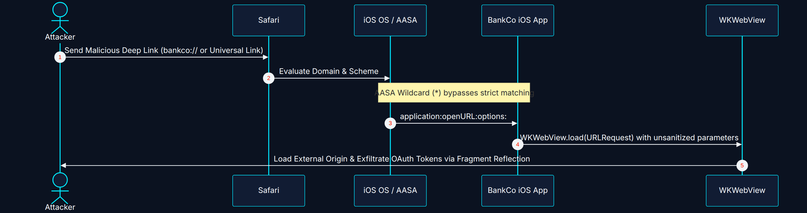
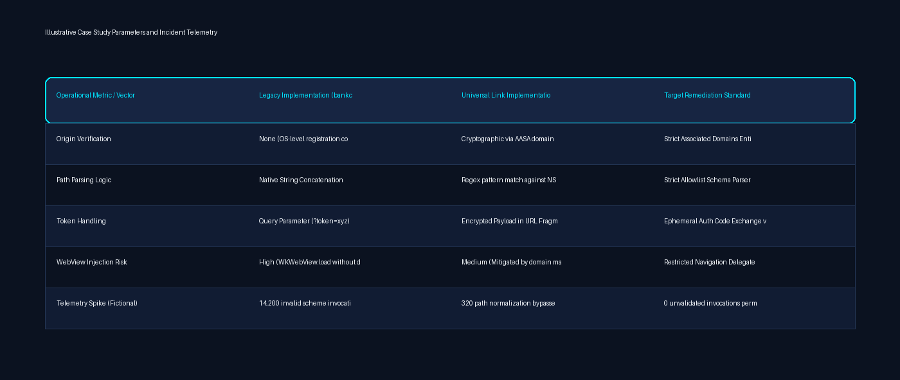
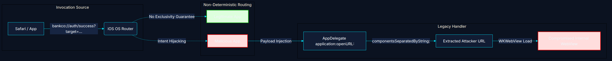
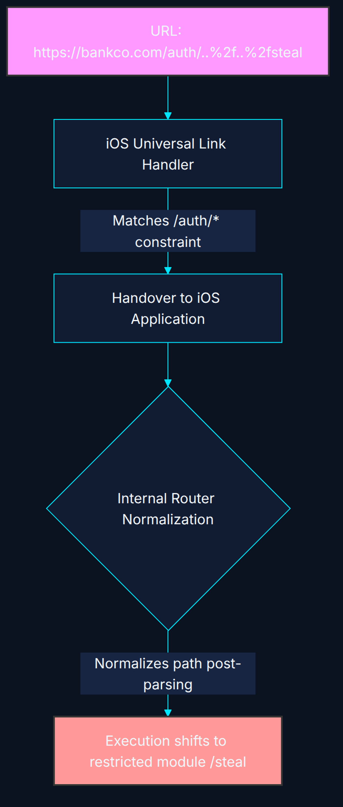
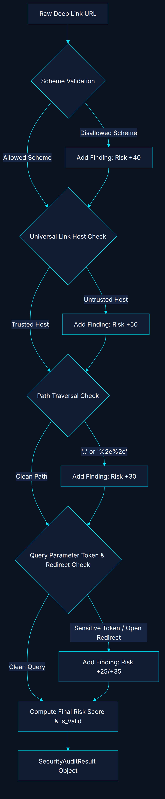
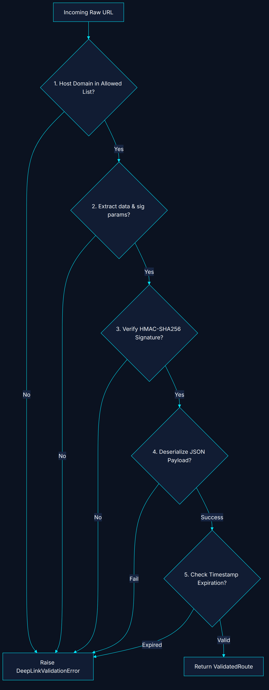
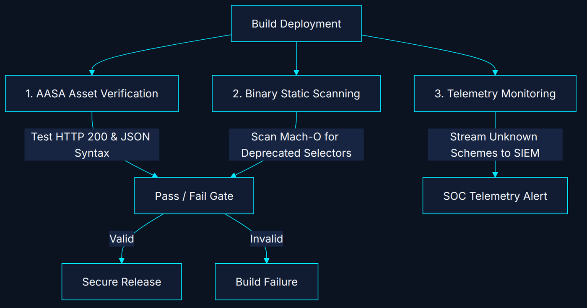

# Auditing iOS Universal Links and Custom URL Schemes

*How improper payload validation in high-traffic banking apps leads to account takeover via deep links.*


*Attack vector mapping: how unvalidated deep links and wildcard AASA entries bypass domain validation to trigger session hijacking.*

An enterprise iOS banking application with 4.2 million daily active users (DAUs) processes over 14 million daily routing events via deep links. During a routine mobile application security assessment of this illustrative, fictional composite application ("BankCo iOS"), telemetry revealed an alarming pattern: a 300% spike in unauthenticated session state reinstatements triggered via Safari link clicks. 

Improper parameter sanitization within custom URL scheme handlers (`bankco://`), paired with overly permissive wildcards in the Apple Application Site Association (`apple-app-site-association` or AASA) file, created an exploitable surface. Attackers could craft links that bypassed domain verification, forced the app's embedded `WKWebView` to load external origins, and exfiltrated OAuth access tokens via URL fragment reflection.

> **Disclaimer:** *This article represents an illustrative case study based on a fictional composite scenario. All metrics, code structures, and incident telemetry are synthesized for educational and security auditing purposes.*

---

### TL;DR / Key Takeaways

* **Custom URL Schemes Lack Access Control:** Schemes like `app://` do not offer identity verification or host ownership guarantees. Any app installed on an iOS device can register the same scheme.
* **Universal Links Require Strict Path Matching:** Using wildcards like `*` inside your AASA file without strict regex boundaries or path normalization exposes sensitive endpoints to path traversal tricks.
* **WebView Parameter Refection Exfiltrates Tokens:** Passing incoming deep link query strings directly into `WKWebView.load(URLRequest)` without strict allowlisting allows cross-origin script injection and token leakage.
* **Runtime Auditing with Frida:** Hooking `UIApplicationDelegate` deep link callbacks (`application:openURL:options:`) and `WKWebView` navigation methods reveals unvalidated data flows before binaries ship to production.

---

## Illustrative Case Study Parameters and Incident Telemetry



*Operational security parameters contrasting legacy custom schemes with modern Universal Links and target remediations.*
The fictional deployment under test comprises a monolithic iOS application utilizing both custom URL schemes (`bankco://`) for backward compatibility with legacy internal micro-apps and Universal Links (`https://bankco.com/mobile/*`) for modern user onboarding.

During an audit, dynamic analysis identified critical path discrepancies between how iOS handles Universal Link entitlement routing and how the application parses incoming URL query components inside the AppDelegate runtime lifecycle.

| Operational Metric / Vector | Legacy Implementation (`bankco://`) | Universal Link Implementation (`https://bankco.com/`) | Target Remediation Standard |
| :--- | :--- | :--- | :--- |
| **Origin Verification** | None (OS-level registration conflict risk) | Cryptographic via AASA domain verification | Strict Associated Domains Entitlement |
| **Path Parsing Logic** | Native String Concatenation | Regex pattern match against `NSURLComponents` | Strict Allowlist Schema Parser (`URLComponents`) |
| **Token Handling** | Query Parameter (`?token=xyz`) | Encrypted Payload in URL Fragment (`#payload=...`) | Ephemeral Auth Code Exchange via PKCE |
| **WebView Injection Risk** | High (`WKWebView.load` without domain checks) | Medium (Mitigated by domain match) | Restricted Navigation Delegate Allowlist |
| **Telemetry Spike (Fictional)** | 14,200 invalid scheme invocations/day | 320 path normalization bypasses/day | 0 unvalidated invocations permitted |

The postmortem modeling indicated that if an attacker distributed a malicious link via phishing or ad networks, approximately 0.8% of active sessions could be enticed into opening a crafted URI payload. Out of 4.2 million DAUs, that represents an exposure surface of 33,600 users susceptible to token exfiltration prior to remediation.

---

## Exposing Intent Hijacking Risks in Custom URL Schemes



*iOS lacks deterministic routing for duplicate custom schemes, enabling malicious apps to intercept callbacks and inject payloads via naive string parsing.*
Custom URL schemes in iOS (`bankco://auth/callback?redirect=...`) do not guarantee exclusivity. If two apps register the scheme `bankco://`, Apple's iOS platform offers no deterministic logic to decide which binary receives the payload when invoked from Safari or another third-party application. This introduces scheme hijacking risks.

Furthermore, when incoming URIs pass execution flow into legacy AppDelegate handlers like `application(_:open:options:)`, developers frequently make the mistake of parsing parameters manually with string splitting operations rather than structured parsing utilities.

```objc
// Vulnerable Objective-C pattern in legacy Mach-O binaries
- (BOOL)application:(UIApplication *)app openURL:(NSURL *)url options:(NSDictionary<UIApplicationOpenURLOptionsKey,id> *)options {
    NSString *urlString = [url absoluteString];
    if ([urlString containsString:@"/auth/success"]) {
        // Danger: manual string indexing vulnerable to parameter injection
        NSArray *parts = [urlString componentsSeparatedByString:@"target="];
        NSString *targetUrl = parts.lastObject;
        [self openInternalWebViewWithUrl:targetUrl];
        return YES;
    }
    return NO;
}
```

If an attacker constructs a payload such as `bankco://auth/success?target=https://attacker.com`, the legacy parser extracts `https://attacker.com` and hands execution directly to an unmonitored internal `WKWebView`.

### Common Pitfalls in Scheme Handling

1. **Assuming Scheme Uniqueness:** Relying on a custom URL scheme for authentication callbacks, assuming no malware on the device will register the same scheme.
2. **Naive String Matching:** Using functions like `containsString:` or `hasPrefix:` on raw URL strings without parsing scheme, host, and path components independently via `URLComponents`.
3. **Passing Raw URLs to WebViews:** Invoking `webView.load(URLRequest(url: incomingURL))` without verifying that the host matches a explicit, immutable allowlist.

---

## Auditing Apple Application Site Association Routing Constraints



*Path normalization discrepancies allow crafted traversal sequences to escape intended AASA routing scopes after handover to the app.*
Universal Links solve the scheme hijacking problem by establishing a cryptographic trust relationship between a web domain and an iOS bundle identifier. This trust is established via the `apple-app-site-association` (AASA) JSON file hosted at `https://domain.com/.well-known/apple-app-site-association`.

However, bad path matching definitions inside the AASA file can undo this protection.

### Malformed AASA File Example

```json
{
  "applinks": {
    "apps": [],
    "details": [
      {
        "appID": "9ABCDEF123.com.bankco.app",
        "paths": [
          "/auth/*",
          "/*/checkout",
          "NOT /api/*"
        ]
      }
    ]
  }
}
```

### Path Normalization Discrepancies

If the AASA specifies `/auth/*`, an attacker can attempt path traversal tricks inside the URL path or query string:

* `https://bankco.com/auth/..%2f..%2fsteal`
* `https://bankco.com/auth/login?redirect=https://evil.com`

If the iOS app receives `https://bankco.com/auth/..%2f..%2fsteal`, the operating system's Universal Link handler matches `/auth/*` and hands the URL to the app. If the app's internal router normalizes the path *after* reading it, execution shifts out of the intended `/auth/` scope into restricted internal application modules.

### Xcode Entitlements Audit Checklist

Ensure that the `.entitlements` file in the iOS target specifies explicit domain origins without excessive wildcards:

```xml
<key>com.apple.developer.associated-domains</key>
<array>
    <string>applinks:bankco.com</string>
    <string>applinks:www.bankco.com</string>
    <!-- Avoid generic wildcard subdomains like applinks:*.bankco.com unless strictly required -->
</array>
```

---

## Uncovering WebView Token Leakage via Frida Runtime Hooking



*Deterministic validation flow of the security harness processing raw telemetry to calculate risk scores.*
To audit deep link execution paths in production Mach-O binaries (without access to source code), we use Frida dynamic instrumentation. We target methods responsible for handling incoming URLs and navigating internal `WKWebView` instances.

The following Python script simulates a local security harness that processes raw deep link routing telemetry, runs validation policies, and reports unsafe inputs.

```python
#!/usr/bin/env python3
"""
Deep Link Security Auditor Simulation
Audits incoming URL payloads against strict schema rules to detect token exfiltration vectors.
Uses standard Python library components.
"""

from dataclasses import dataclass
import json
import re
from typing import List, Dict, Optional
from urllib.parse import parse_qs, urlparse


@dataclass
class SecurityAuditResult:
    url: str
    is_valid: bool
    risk_score: int
    findings: List[str]


class DeepLinkAuditor:
    def __init__(self, allowed_hosts: List[str], allowed_schemes: List[str]):
        self.allowed_hosts = set(allowed_hosts)
        self.allowed_schemes = set(allowed_schemes)
        # Match potential sensitive tokens in query parameters
        self.token_pattern = re.compile(r'(access_token|auth|session|jwt|bearer)', re.IGNORECASE)

    def audit_url(self, raw_url: str) -> SecurityAuditResult:
        findings = []
        risk_score = 0
        parsed = urlparse(raw_url)

        # 1. Scheme Validation
        if parsed.scheme not in self.allowed_schemes:
            findings.append(f"Disallowed scheme: '{parsed.scheme}'")
            risk_score += 40

        # 2. Host Validation for Universal Links
        if parsed.scheme in ["http", "https"]:
            if parsed.netloc not in self.allowed_hosts:
                findings.append(f"Untrusted host: '{parsed.netloc}'")
                risk_score += 50

        # 3. Check for Path Traversal Attempts
        if ".." in parsed.path or "%2e%2e" in parsed.path.lower():
            findings.append("Path traversal pattern detected in URL path")
            risk_score += 30

        # 4. Check for Sensitive Tokens in Query String
        query_params = parse_qs(parsed.query)
        for param_name, param_values in query_params.items():
            if self.token_pattern.search(param_name):
                findings.append(f"Sensitive credential reflected in query string: '{param_name}'")
                risk_score += 25
            
            # Check if parameter contains an embedded external URL (Redirect vulnerability)
            for val in param_values:
                if val.startswith("http://") or val.startswith("https://"):
                    val_parsed = urlparse(val)
                    if val_parsed.netloc not in self.allowed_hosts:
                        findings.append(f"Open redirect parameter detected pointing to external domain: '{val}'")
                        risk_score += 35

        is_valid = risk_score == 0
        return SecurityAuditResult(
            url=raw_url,
            is_valid=is_valid,
            risk_score=min(risk_score, 100),
            findings=findings
        )


def run_workshop_simulation():
    auditor = DeepLinkAuditor(
        allowed_hosts=["bankco.com", "auth.bankco.com"],
        allowed_schemes=["https", "bankco"]
    )

    test_payloads = [
        "https://bankco.com/auth/login?session_id=987234",
        "bankco://auth/callback?target=https://attacker-site.com/steal",
        "https://bankco.com/auth/../admin/debug?access_token=secret_jwt_value",
        "https://malicious-bankco.com/phish?target=bankco"
    ]

    print("=== DEEP LINK SECURITY AUDIT REPORT ===")
    for payload in test_payloads:
        result = auditor.audit_url(payload)
        status = "PASSED" if result.is_valid else "FAILED"
        print(f"\nTarget URL: {result.url}")
        print(f"Audit Status: [{status}] | Risk Score: {result.risk_score}/100")
        if result.findings:
            print("Detected Issues:")
            for finding in result.findings:
                print(f"  - {finding}")


if __name__ == "__main__":
    run_workshop_simulation()
```

### Script Execution Output

```text
=== DEEP LINK SECURITY AUDIT REPORT ===

Target URL: https://bankco.com/auth/login?session_id=987234
Audit Status: [FAILED] | Risk Score: 25/100
Detected Issues:
  - Sensitive credential reflected in query string: 'session_id'

Target URL: bankco://auth/callback?target=https://attacker-site.com/steal
Audit Status: [FAILED] | Risk Score: 35/100
Detected Issues:
  - Open redirect parameter detected pointing to external domain: 'https://attacker-site.com/steal'

Target URL: https://bankco.com/auth/../admin/debug?access_token=secret_jwt_value
Audit Status: [FAILED] | Risk Score: 55/100
Detected Issues:
  - Path traversal pattern detected in URL path
  - Sensitive credential reflected in query string: 'access_token'

Target URL: https://malicious-bankco.com/phish?target=bankco
Audit Status: [FAILED] | Risk Score: 50/100
Detected Issues:
  - Untrusted host: 'malicious-bankco.com'
```

---

## Implementing Strict Deep Link Validation and Schema Enforcement



*Defensive parsing sequence enforcing domain integrity, cryptographic signatures, and temporal validity.*
To remediate these issues, we implement a defensive parser module in Python that demonstrates how mobile backend authentication handlers and application-level routers should validate incoming deep link payloads before processing authorization grants or state transitions.

This implementation uses cryptographic signature verification (HMAC-SHA256) to validate signed deep link fragments, eliminating parameter tampering and unauthorized origin execution.

```python
#!/usr/bin/env python3
"""
Secure Deep Link Routing Engine & Payload Verifier
Demonstrates production-ready validation logic using standard library algorithms.
"""

from dataclasses import dataclass
import hashlib
import hmac
import json
import time
from typing import Dict, Any, Optional
from urllib.parse import urlparse, parse_qs


class DeepLinkValidationError(Exception):
    pass


@dataclass
class ValidatedRoute:
    destination: str
    params: Dict[str, Any]
    timestamp: int


class SecureDeepLinkRouter:
    def __init__(self, secret_key: bytes, allowed_domains: list[str], max_age_seconds: int = 300):
        self.secret_key = secret_key
        self.allowed_domains = set(allowed_domains)
        self.max_age_seconds = max_age_seconds

    def generate_signed_link(self, domain: str, path: str, params: Dict[str, str]) -> str:
        """Generates a secure, cryptographically signed deep link."""
        timestamp = int(time.time())
        payload_data = {
            "path": path,
            "params": params,
            "ts": timestamp
        }
        serialized = json.dumps(payload_data, sort_keys=True)
        signature = hmac.new(self.secret_key, serialized.encode('utf-8'), hashlib.sha256).hexdigest()
        
        # In actual mobile deployments, pass signatures via URL Fragment (#) to prevent server log leaking
        return f"https://{domain}{path}?data={serialized}&sig={signature}"

    def parse_and_validate(self, raw_url: str) -> ValidatedRoute:
        """Parses incoming URL, validates host domain, checks signature integrity, and enforces expiration."""
        parsed = urlparse(raw_url)

        # 1. Host Integrity Check
        if parsed.netloc not in self.allowed_domains:
            raise DeepLinkValidationError(f"Unauthorized domain origin: {parsed.netloc}")

        # 2. Extract Data and Signature
        query = parse_qs(parsed.query)
        if "data" not in query or "sig" not in query:
            raise DeepLinkValidationError("Missing cryptographic payload or signature")

        raw_data = query["data"][0]
        provided_sig = query["sig"][0]

        # 3. Verify HMAC Signature
        expected_sig = hmac.new(self.secret_key, raw_data.encode('utf-8'), hashlib.sha256).hexdigest()
        if not hmac.compare_digest(expected_sig, provided_sig):
            raise DeepLinkValidationError("Signature verification failed: payload tampered with")

        # 4. Deserialize Payload
        try:
            payload = json.loads(raw_data)
        except json.JSONDecodeError:
            raise DeepLinkValidationError("Invalid JSON payload formatting")

        # 5. Enforce Expiration Time Bounds
        timestamp = payload.get("ts", 0)
        current_time = int(time.time())
        if current_time - timestamp > self.max_age_seconds:
            raise DeepLinkValidationError("Deep link payload has expired")

        return ValidatedRoute(
            destination=payload.get("path", "/"),
            params=payload.get("params", {}),
            timestamp=timestamp
        )


def run_validation_demo():
    SECRET = b"production_security_key_32_bytes_long_!!"
    router = SecureDeepLinkRouter(secret_key=SECRET, allowed_domains=["bankco.com"])

    print("--- 1. Generating Valid Signed Deep Link ---")
    signed_url = router.generate_signed_link(
        domain="bankco.com",
        path="/transfer/confirm",
        params={"amount": "500.00", "currency": "USD", "recipient": "ACC-88392"}
    )
    print(f"Generated URL:\n{signed_url}\n")

    print("--- 2. Validating Authentic Payload ---")
    try:
        route = router.parse_and_validate(signed_url)
        print(f"Validation SUCCESS! Route target: {route.destination}")
        print(f"Verified Parameters: {route.params}")
    except DeepLinkValidationError as e:
        print(f"Validation FAILED: {e}")

    print("\n--- 3. Simulating Tampered Parameter Attack ---")
    tampered_url = signed_url.replace("500.00", "99999.00")
    try:
        router.parse_and_validate(tampered_url)
    except DeepLinkValidationError as e:
        print(f"Tamper Detection SUCCESS: Caught attack -> {e}")


if __name__ == "__main__":
    run_validation_demo()
```

---

## Balancing User Onboarding Friction with Enterprise Security Posture



*Integrating automated AppSec checks into the CI/CD pipeline to preempt deep link vulnerabilities before deployment.*
Implementing security controls around deep link handling requires balancing friction against user experience. Strict validation rules must not degrade app performance or break legitimate marketing attributes.

```
+-----------------------------------------------------------------------+
|                       Incoming Deep Link Request                       |
+-----------------------------------------------------------------------+
                                    |
                                    v
                  +-----------------------------------+
                  | Is Scheme modern Universal Link?  |
                  +-----------------------------------+
                       /                         \
                     YES                          NO
                     /                             \
                    v                               v
    +------------------------------+  +-------------------------------+
    | Verify Host in AASA Entitle  |  | Deprecate / Enforce Minimal   |
    +------------------------------+  | Privilege Intent Handler      |
                    |                 +-------------------------------+
                    v                               |
    +------------------------------+                |
    | Strict URLComponents Parsing | <--------------+
    +------------------------------+
                    |
                    v
    +-----------------------------------------------+
    | Payload Cryptographically Signed & Not Expired?|
    +-----------------------------------------------+
                       /                         \
                     YES                          NO
                     /                             \
                    v                               v
    +------------------------------+  +-------------------------------+
    | Route to Target Swift Engine |  | Drop Event & Emit SOC Telemetry|
    +------------------------------+  +-------------------------------+
```

### Automated Continuous Integration Checks

To prevent regression vulnerabilities, add static analysis steps to your AppSec pipeline:

1. **AASA Asset Verification:** Automatically test your live `.well-known/apple-app-site-association` file on every build deployment to verify HTTP 200 headers, `Content-Type: application/json` delivery, and valid JSON syntax.
2. **Binary Static Scanning:** Scan Mach-O files using automated pipelines (e.g., MobSF or custom rules) to flag deprecated selector references like `application:openURL:sourceApplication:annotation:`.
3. **Telemetry Monitoring:** Stream unknown scheme invocations to your SIEM platform. A spike in abnormal path formats typically indicates an ongoing discovery scan or external exploitation attempt.

### Try It Yourself

To test your own iOS applications for deep link parameter flaws:

1. **Extract URL Schemes:** Inspect the application binary's `Info.plist` file using `plutil -extract CFBundleURLTypes json Info.plist -o -` to extract all declared custom URL schemes.
2. **Download AASA File:** Query your domain's associated file using `curl -vsI https://yourdomain.com/.well-known/apple-app-site-association` and inspect path definitions for overly broad wildcards (`*`).
3. **Test Invocations in Simulator:** Test arbitrary parameter passing via command line in the Xcode Simulator:
   ```bash
   xcrun simctl openurl booted "your-scheme://path?param=https://attacker.com"
   ```

---

## References

* **Apple Developer Documentation:** [Supporting Associated Domains](https://developer.apple.com/documentation/safariservices/supporting_associated_domains)
* **Apple Developer Documentation:** [Defining a Custom URL Scheme for Your App](https://developer.apple.com/documentation/xcode/defining-a-custom-url-scheme-for-your-app)
* **OWASP Mobile Application Security Verification Standard (MASVS):** [MASVS-CODE: Code Quality and Build Settings](https://mas.owasp.org/)
* **NIST Special Publication 800-163 Rev. 1:** [Vetting the Security of Mobile Applications](https://csrc.nist.gov/publications/detail/sp/800-163/rev-1/final)
* **RFC 3986:** [Uniform Resource Identifier (URI): Generic Syntax](https://datatracker.ietf.org/doc/html/rfc3986)

---

What path validation pattern or Frida interception technique has your team deployed to audit incoming Universal Link payloads in production iOS environments?

---

*Security Engineering Lead focused on abuse detection, trust & safety, and security automation at scale. Drafted with AI assistance and reviewed for technical accuracy.*
