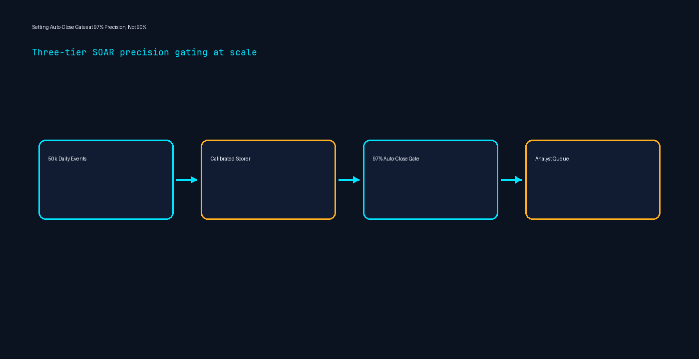
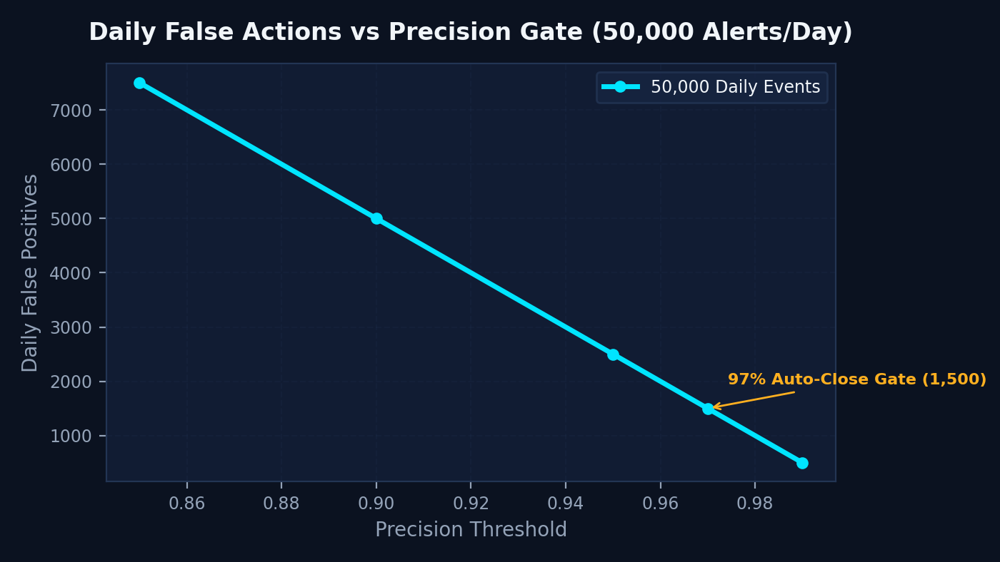
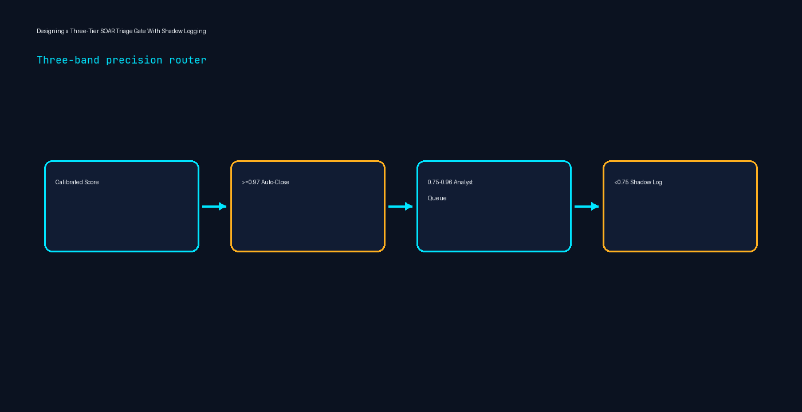
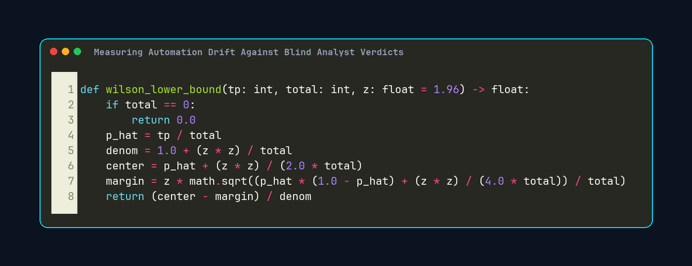
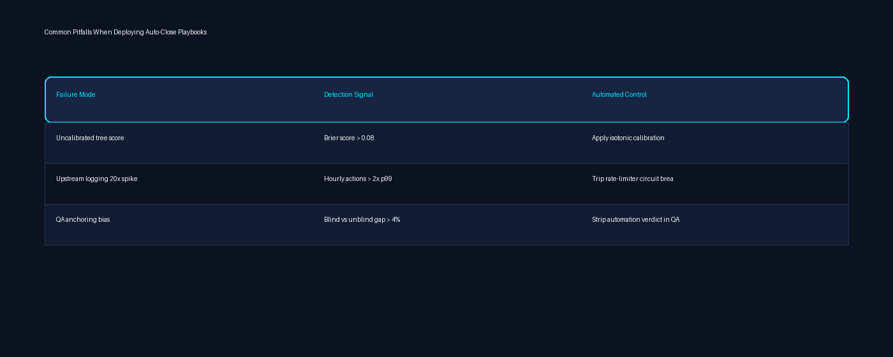

# Setting Auto-Close Gates at 97% Precision, Not 90%

*Why a 90% precision detector still floods a 50,000-event SOC queue—and how to calibrate human-in-the-loop SOAR gates with real base-rate math.*


*A 97% precision gate isolates high-confidence closures while preserving analyst bandwidth for ambiguous edge cases.*

At 50,000 daily alerts, a detection model boasting 90% precision still generates **5,000 false positives every 24 hours**. If your SOAR playbook auto-closes or auto-suspends on that signal, you are either breaking legitimate user workflows 5,000 times a day or dumping 5,000 noisy escalations onto an on-call rotation that can only triage 300 tickets per shift.

### TL;DR / Key Takeaways
- **90% precision is an operational failure at scale:** Base-rate math turns seemingly "good" F1 scores into thousands of daily false closures or analyst escalations.
- **Separate the auto-close gate from the escalation gate:** Require `>= 0.97` precision for automated containment/closure, route `0.75–0.96` to human review, and suppress `< 0.75` into shadow telemetry.
- **Measure automation against blind analyst verdicts:** Sample 2% of auto-closed events weekly for senior analyst QA to catch silent rule decay before attackers adapt.
- **Backfill before flipping the switch:** Replay candidate thresholds across 90 days of historical telemetry to bound worst-case daily false-positive volume.

---

## Why 90% Precision Fails the Base-Rate Math in High-Volume Queues


*Moving the auto-action gate from 0.90 to 0.97 cuts daily false actions from 5,000 to 1,500—and pairs with shadow suppression to fit analyst capacity.*

Most detection engineering teams evaluate a new heuristic or classifier in isolation: they pull a balanced validation set, celebrate a 0.91 precision score, and wire it straight into a SOAR playbook. In production, class balance is rarely 50/50. In large-scale abuse and fraud pipelines, true positives frequently sit between **0.5% and 2.0%** of total evaluated events.

When the base rate is 1%, Bayes' theorem dictates that even a detector with 98% true-positive rate and 2% false-positive rate yields a positive predictive value (precision) of only **33.1%**. Even after upstream pre-filtering raises the candidate precision to 90%, volume magnifies the remaining 10% error rate into an operational outage.

| Gate Threshold | Precision | Daily Volume (50k) | Daily False Actions | Weekly QA Sample (2%) |
| --- | --- | --- | --- | --- |
| 0.85 | 85% | 50,000 | 7,500 | 1,000 |
| 0.90 | 90% | 50,000 | 5,000 | 1,000 |
| 0.95 | 95% | 50,000 | 2,500 | 1,000 |
| 0.97 | 97% | 50,000 | 1,500 | 1,000 |
| 0.99 | 99% | 50,000 | 500 | 1,000 |

## Designing a Three-Tier SOAR Triage Gate With Shadow Logging


*Splitting a single binary threshold into three bands prevents both silent customer impact and analyst queue saturation.*

Instead of a binary `alert / ignore` switch, production SOAR pipelines need three explicit bands:

1. **Auto-Action Band (`precision >= 0.97`):** High-confidence signals (e.g., deterministic credential-stuffing signatures, verified replay hashes) execute automated containment or auto-closure immediately, with a 2% random sample routed to blind QA.
2. **Human-in-the-Loop Band (`0.75 <= precision < 0.97`):** Ambiguous events enter the analyst queue, ordered by expected impact and SLA deadline.
3. **Shadow Telemetry Band (`precision < 0.75`):** Events are logged to cold storage for backfill and clustering, never waking an analyst.

```python
from dataclasses import dataclass

@dataclass(frozen=True)
class TriageDecision:
    band: str
    auto_execute: bool
    sample_for_qa: bool

def route_event(calibrated_precision: float, event_hash_mod_100: int) -> TriageDecision:
    if calibrated_precision >= 0.97:
        return TriageDecision(
            band="AUTO_CLOSE",
            auto_execute=True,
            sample_for_qa=(event_hash_mod_100 < 2),
        )
    if calibrated_precision >= 0.75:
        return TriageDecision(
            band="ANALYST_QUEUE",
            auto_execute=False,
            sample_for_qa=False,
        )
    return TriageDecision(
        band="SHADOW_LOG",
        auto_execute=False,
        sample_for_qa=False,
    )

assert route_event(0.98, 1) == TriageDecision("AUTO_CLOSE", True, True)
assert route_event(0.84, 50) == TriageDecision("ANALYST_QUEUE", False, False)
```

## Measuring Automation Drift Against Blind Analyst Verdicts


*Computing a 95% Wilson lower bound on weekly QA samples catches rule decay before precision drops below 0.97.*

Static thresholds rot. Attackers rotate infrastructure, legitimate product flows change, and a rule that delivered 98.2% precision in Q1 can quietly drift to 88% in Q2. Because auto-closed events leave the human queue, **you will not hear analysts complain about false negatives or false closures** unless you actively audit them.

By hashing each auto-closed event ID modulo 100 and routing `0` and `1` into a blind QA queue—stripped of the automation's own verdict—you obtain an unbiased weekly precision estimate. Always gate on the **95% Wilson score lower bound** rather than the raw sample mean so small weekly sample sizes do not mask regressions.

```python
import math

def wilson_lower_bound(tp: int, total: int, z: float = 1.96) -> float:
    if total == 0:
        return 0.0
    p_hat = tp / total
    denom = 1.0 + (z * z) / total
    center = p_hat + (z * z) / (2.0 * total)
    margin = z * math.sqrt((p_hat * (1.0 - p_hat) + (z * z) / (4.0 * total)) / total)
    return (center - margin) / denom

# 192 confirmed true positives out of 200 blind QA samples
lb = wilson_lower_bound(192, 200)
print(f"95% Wilson lower bound: {lb:.4f}")
assert lb < 0.97  # Triggers automatic demotion from AUTO_CLOSE to ANALYST_QUEUE
```

## Common Pitfalls When Deploying Auto-Close Playbooks


*Explicit rollback triggers ensure degraded rules demote to shadow mode within one evaluation window.*

- **Calibrating on raw model probabilities instead of empirical precision:** A tree ensemble's `0.97` score is not a 97% true-positive probability without isotonic or Platt scaling on production traffic.
- **Omitting circuit breakers on hourly volume spikes:** Even a 99% precision rule will cause an incident if an upstream logging bug multiplies event volume by 20x. Cap hourly auto-actions with a hard rate limiter.
- **Letting QA reviewers see the automation's label:** Anchoring bias inflates apparent precision by 4–8 percentage points when reviewers know the system already auto-closed the ticket.

## Try It Yourself: Backfilling Precision Gates Over Synthetic Telemetry

Run the snippet below locally to simulate 30 days of rule drift (`0.5%` daily precision decay) and observe the exact day the Wilson lower bound trips the demotion circuit breaker:

```python
import math
import random

def wilson_lower_bound(tp: int, total: int, z: float = 1.96) -> float:
    p_hat = tp / total
    denom = 1.0 + (z * z) / total
    center = p_hat + (z * z) / (2.0 * total)
    margin = z * math.sqrt((p_hat * (1.0 - p_hat) + (z * z) / (4.0 * total)) / total)
    return (center - margin) / denom

random.seed(42)
for day in range(1, 31):
    true_precision = max(0.70, 0.985 - 0.004 * day)
    qa_total = 100
    qa_tp = sum(1 for _ in range(qa_total) if random.random() < true_precision)
    lb = wilson_lower_bound(qa_tp, qa_total)
    if lb < 0.93:
        print(f"Day {day}: DEMOTED (sample_tp={qa_tp}/{qa_total}, wilson_lb={lb:.3f})")
        break
```

**Closing Thought:** Automation precision is not a model-training metric; it is a production SLA between your detection pipeline and your users. **What is the lowest precision threshold your team currently allows for automated containment, and how often do you audit its blind false-closure rate?**

## Verified Technical References

- NIST SP 800-53 Rev. 5 — Security and Privacy Controls (AU-6 Audit Record Review, Analysis, and Reporting): https://csrc.nist.gov/publications/detail/sp/800-53/rev-5/final
- MITRE ATT&CK — Defense Evasion & Detection Engineering Concepts: https://attack.mitre.org/
- OWASP Logging Cheat Sheet — Event Design and Integrity: https://cheatsheetseries.owasp.org/cheatsheets/Logging_Cheat_Sheet.html

---

*Security Engineering Lead focused on abuse detection, trust & safety, and security automation at scale. Drafted with AI assistance and reviewed for technical accuracy.*
